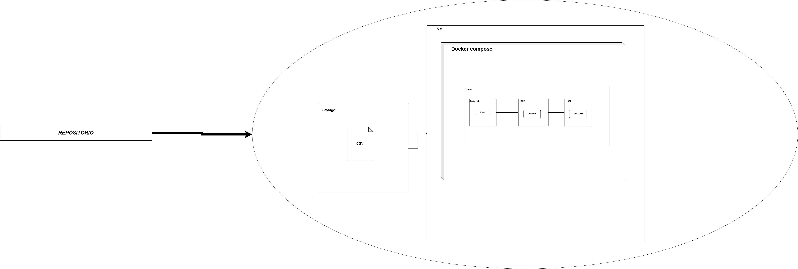

# ETL PIPELINE CASE STUDY EBURY
Pipeline using Airflow, dbt, postgreSQL and the possibility of use in Docker

**Stack:** PostgreSQL 16 · Apache Airflow 2.10 · dbt-core 1.9 (dbt-postgres) · Docker Compose


**Requirements:** Docker and Docker Compose.

```bash
# 1. Create your local environment file
cp .env.example .env
#    (Linux only) set AIRFLOW_UID to the output of: id -u

# 2. Build and start everything
docker compose up -d --build

# 3. Open Airflow
#    http://localhost:8080   (port set by AIRFLOW_PORT in .env)
```

**Run the pipeline**
the pipeline runs automatically on startup

## Architecture


## Repository structure

```
.
├── compose.yaml              # postgres, airflow_db (Airflow metadata), airflow
├── .env.example              # environment variables (copy to .env)
├── data/
│   └── customer_transactions.csv
├── airflow/
│   ├── Dockerfile            # Airflow image + dbt virtualenv
│   ├── requirements.txt
│   └── dags/
│       ├── common/dataset.py # Datasets that chain the DAGs
│       ├── bronze_dag.py
│       ├── silver_dbt_dag.py
│       └── gold_dbt_dag.py
└── dbt/
    ├── dbt_project.yml
    ├── profiles.yml
    ├── models/silver/        # silver model, source and tests
    ├── models/gold/          # dim, fact and aggregate
    └── tests/{silver,gold}/  # singular tests
```

## Data model

- **`dim_products`**: one row per `product_id` (`product_id`, `product_name`).
- **`fact_transactions`**: one row per `transaction_id` (`customer_id`, `product_id`, `transaction_date`, `quantity`, `unit_price`, `tax`, `total_amount`).
  `total_amount = quantity * unit_price + tax`
- **`agg_monthly_sales`**: monthly transactions, units sold and revenue (`total_revenue_month`).
